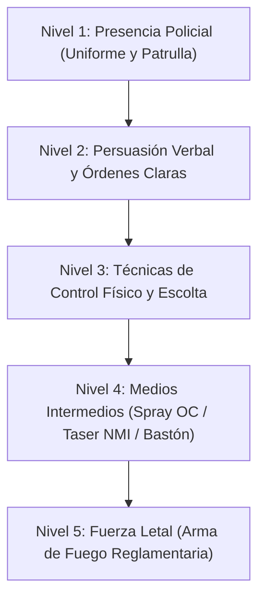

# 📚 Manual Práctico de Actuación Jurídico-Policial en España

> **DESTINATARIOS**: Agentes en servicio del Cuerpo Nacional de Policía (CNP), Guardia Civil, Policías Autonómicas y Locales en el entorno operativo de simulación **LSPDFR Spanish Police Suite**.
>
> **FINALIDAD**: Servir de compendio legal y operativo integral, unificando la legislación constitucional, procesal, administrativa y penal de España para garantizar intervenciones 100% ajustadas a derecho en vía pública.

---

## 📑 ÍNDICE GENERAL

1. [TÍTULO I: Marco Constitucional y Principios Básicos de Actuación](#título-i-marco-constitucional-y-principios-básicos-de-actuación)
2. [TÍTULO II: Seguridad Ciudadana e Intervenciones en Vía Pública (LO 4/2015)](#título-ii-seguridad-ciudadana-e-intervenciones-en-vía-pública-lo-42015)
3. [TÍTULO III: La Detención y el Estatuto de la Persona Custodiada (LECrim)](#título-iii-la-detención-y-el-estatuto-de-la-persona-custodiada-lecrim)
4. [TÍTULO IV: Código Penal Aplicado al Servicio Policial (LO 10/1995)](#título-iv-código-penal-aplicado-al-servicio-policial-lo-101995)
5. [TÍTULO V: Seguridad Vial y Tráfico (DGT y Delitos Viales)](#título-v-seguridad-vial-y-tráfico-dgt-y-delitos-viales)
6. [TÍTULO VI: Uso Proporcional de la Fuerza y Medios Intermedios](#título-vi-uso-proporcional-de-la-fuerza-y-medios-intermedios)
7. [TÍTULO VII: Protocolo Operativo Táctico (Entrada CQB e IFAK)](#título-vii-protocolo-operativo-táctico-entrada-cqb-e-ifak)
8. [TÍTULO VIII: Redacción de Atestados y Documentación Judicial](#título-viii-redacción-de-atestados-y-documentación-judicial)
9. [ANEXO: Tabla de Tipificación y Consulta Rápida](#anexo-tabla-de-tipificación-y-consulta-rápida)

---

## 🎮 CÓMO CONSULTAR Y APLICAR EL MARCO JURÍDICO DENTRO DEL JUEGO (GTA V)

El marco legal completo está 100% implementado y disponible de forma interactiva mientras patrullas:

1. **Consulta Interactiva del Manual en Servicio**:
   - Pulsa **`F10`** (Terminal SITEL) o **`F9`** (Menú de Intervención) y selecciona **`📖 Manual Jurídico Policial`**.
   - Navega por cualquiera de los 8 Títulos para desplegar en pantalla fichas jurídicas completas con notificaciones sonoras policiales, artículos legales aplicables y protocolos operativos.
2. **Imposición de Sanciones DGT en Vía Pública**:
   - En **`F10`** $\rightarrow$ **`Sanciones DGT`**: Selecciona la infracción observada (velocidad, semáforo, alcoholemia administrativa, móvil, cinturón, etc.). El sistema generará el boletín de denuncia formal con importe en euros y retirada exacta de puntos.
3. **Instrucción de Atestados del Código Penal**:
   - En **`F10`** $\rightarrow$ **`Redactar Atestado Penal`**: Imputa delitos penales (atentado, drogas, violencia de género UFAM, alcoholemia penal Art. 379.2, homicidio, etc.) con sus marcos de penas y remisión al Juzgado de Guardia.
4. **Juicios y Sentencias Reales (`RadioYJusticia`)**:
   - Trasladado el detenido y finalizado el plazo de custodia de 72 horas, el simulador de juicios emitirá resoluciones motivadas con aplicación del Código Penal español y agravantes de reincidencia (Art. 22.8 CP).
5. **Compatibilidad con CompuLite MDT**:
   - Si utilizas el ordenador policial CompuLite, se incluyen los archivos `Charges.xml` y `Citations.xml` en español con todos los delitos y multas de España en `plugins/LSPDFR/CompuLite/`.

---

## TÍTULO I: MARCO CONSTITUCIONAL Y PRINCIPIOS BÁSICOS DE ACTUACIÓN

### 1.1. Constitución Española de 1978 (CE)
Toda intervención policial tiene su límite y fundamento en la Carta Magna:
- **Artículo 17 CE (Derecho a la Libertad y Seguridad)**:
  - Nadie puede ser privado de su libertad sino en los casos y formas previstos en la ley.
  - La detención preventiva no podrá durar más del tiempo estrictamente necesario para la realización de las averiguaciones tendentes al esclarecimiento de los hechos, y, en todo caso, en el **plazo máximo de 72 horas**, el detenido deberá ser puesto en libertad o a disposición judicial.
  - Toda persona detenida debe ser informada de forma inmediata y comprensible de sus derechos y de las razones de su detención.
  - Procedimiento de *Habeas Corpus* para la inmediata puesta a disposición judicial de cualquier persona detenida ilegalmente.
- **Artículo 18 CE (Inviolabilidad del Domicilio y Secreto de Comunicaciones)**:
  - El domicilio es inviolable. Ninguna entrada o registro podrá hacerse en él sin consentimiento del titular o resolución judicial, **salvo en caso de flagrante delito** (*aplicable en las mecánicas de entrada táctica CQB de `TacticalOps.dll`*).
- **Artículo 104 CE (Misión de las Fuerzas y Cuerpos de Seguridad)**:
  - Tienen como misión proteger el libre ejercicio de los derechos y libertades y garantizar la seguridad ciudadana bajo la dependencia del Gobierno.

### 1.2. Ley Orgánica 2/1986 de Fuerzas y Cuerpos de Seguridad (LOFCS)
El **Artículo 5** establece los principios deontológicos de obligado cumplimiento:
1. **Adecuación, Necesidad y Proporcionalidad**: El uso de las armas de fuego y de la fuerza física debe ser la última ratio, empleándose únicamente cuando exista un riesgo racionalmente grave para la vida o integridad física del agente o de terceras personas.
2. **Jerarquía y Subordinación**: Obediencia debida a los mandos, salvo órdenes manifiestamente ilegales o que constituyan delito.
3. **Trato Correcto y Esmerado**: Dignidad, respeto y corrección absoluta en el trato con los ciudadanos en todo momento.

---

## TÍTULO II: SEGURIDAD CIUDADANA E INTERVENCIONES EN VÍA PÚBLICA (LO 4/2015)

La Ley Orgánica 4/2015 de Protección de la Seguridad Ciudadana (LOSC) regula las facultades policiales en espacios públicos:

### 2.1. Identificación de Personas (Artículo 16 LOSC)
- **Supuestos Legales**: Los agentes podrán requerir la identificación de las personas en la vía pública cuando:
  1. Existan indicios de que han podido participar en la comisión de una infracción penal o administrativa.
  2. Sea razonablemente necesario para prevenir la comisión de un delito.
- **Algoritmo DNI Módulo 23**: El documento exhibido debe verificarse con la tabla oficial de 23 caracteres:  
  $$\text{Letra} = \text{TRWAGMYFPDXBNJZSQVHLCKE}[\text{Número} \bmod 23]$$
- **Traslado a Comisaría para Identificación**: Si la persona no acredita su identidad y no es posible lograrlo por otros medios, podrá ser requerida para acompañar a los agentes a las dependencias policiales más próximas exclusivamente por el tiempo imprescindible (máximo legal de 6 horas).

### 2.2. Registros Corporales Superficiales / Cacheos (Artículo 20 LOSC)
- **Requisitos de Procedencia**: Indicios racionales de que la persona porta armas, explosivos, drogas o efectos procedentes de delito.
- **Protocolo de Ejecución (`InterventionMenu.cs - F9`)**:
  - Realizado por agentes del mismo sexo, salvo urgencia inaplazable.
  - Respeto escrupuloso a la intimidad, en lugar reservado si se requiere desprendimiento de prendas que no sean accesorias.

### 2.3. Registro de Vehículos en Vía Pública (Artículo 18 LOSC)
- Los agentes podrán practicar comprobaciones en los vehículos para prevenir la comisión de delitos o incautar efectos prohibidos.
- **Protocolo de Parada de Tráfico (`TrafficStopInteraction.cs`)**:
  1. Solicitud de apagado de motor (`SET_VEHICLE_ENGINE_ON = false`).
  2. Bajada de ventanilla para interlocución segura (`ROLL_DOWN_WINDOW`).
  3. Inspección visual del habitáculo, guantera y maletero.

### 2.4. Dispositivos Estáticos de Control y Bloqueos (Artículo 17 LOSC)
- La policía podrá establecer cortes de vía pública y controles de paso en lugares estratégicos para el descubrimiento y detención de partícipes en delitos de especial gravedad.
- **Uso de Bandas de Clavos (`SpikeStripManager.cs`)**: Despliegue de stinger sobre la calzada para forzar la inmovilización de vehículos que huyen ignorando las órdenes de alto.
- **Bloqueos Tácticos en V (`RoadblockManager.cs`)**: Disposición de unidades patrulla cruzadas con personal armado en cobertura.

---

## TÍTULO III: LA DETENCIÓN Y EL ESTATUTO DEL DETENIDO (LECRIM)

### 3.1. Supuestos Legales de Detención (Artículos 490 y 492 LECrim)
La privación cautelar de libertad solo procede cuando:
1. Al que intentare cometer un delito, en el momento de ir a cometerlo.
2. Al delincuente *in fraganti*.
3. Al que se fugare del establecimiento penal o durante la conducción policial.
4. Al imputado o procesado que estuviere en rebeldía con orden judicial de búsqueda y captura en vigor (`SitelComputerMenu.cs - F10`).
5. A quien no ofreciere fianza bastante o domicilio conocido tras cometer un delito.

### 3.2. Información Formal de Derechos (Artículo 520 LECrim)
En el instante de colocar los grilletes (`PedControlManager.cs`), es imperativa la lectura inmediata y comprensible de los siguientes derechos:
1. **Derecho a guardar silencio**: No declarar si no quiere, no contestar a preguntas concretas o declarar únicamente ante la autoridad judicial.
2. **Derecho a no declarar contra sí mismo**: Y a no confesarse culpable.
3. **Derecho a la designación de abogado**: De libre elección o letrado del turno de oficio del Colegio de Abogados.
4. **Derecho a la comunicación telefónica**: A poner en conocimiento de un familiar o persona que designe el hecho de su detención y el lugar de custodia policial.
5. **Derecho a la asistencia consular**: Si es de nacionalidad extranjera.
6. **Derecho a intérprete gratuito**: Si es extranjero o no comprende el castellano.
7. **Derecho a ser reconocido por el Médico Forense** adscrito al juzgado.

### 3.3. Régimen Temporal de Custodia Policial (Reloj de 72 Horas)
- Conforme al Art. 17.2 CE y Art. 520.1 LECrim, la detención no puede durar más de 72 horas.
- Vencido el plazo o concluidas las diligencias de atestado, el detenido debe ser:
  - **Puesto en libertad con cargos** en sede policial con obligación de comparecer ante el juez.
  - **Puesto a disposición física** del Juzgado de Instrucción de Guardia.

---

## TÍTULO IV: CÓDIGO PENAL APLICADO AL SERVICIO POLICIAL (LO 10/1995)

Tipificación y penas de las infracciones penales atendidas en patrulla:

### 4.1. Delitos contra el Orden Público y Autoridad
- **Atentado contra Agentes de la Autoridad (Art. 550 CP)**: Agresión física o resistencia activa grave con intimidación dirigida a funcionarios de policía en el ejercicio de sus funciones.
  - *Pena*: Prisión de 1 a 4 años y multa de 3 a 6 meses.
- **Resistencia y Desobediencia Grave (Art. 556 CP)**: Negativa reiterada y tenaz al cumplimiento de órdenes legítimas impartidas por agentes.
  - *Pena*: Prisión de 3 meses a 1 año o multa de 6 a 18 meses.

### 4.2. Delitos contra la Vida y la Integridad Física
- **Homicidio (Art. 138 CP)**: Causar la muerte dolosa a otro individuo (Prisión de 10 a 15 años).
- **Asesinato (Art. 139 CP)**: Con alevosía, precio/recompensa o ensañamiento (Prisión de 15 a 25 años).
- **Lesiones (Art. 147 CP)**: Menoscabo físico que requiere objetivamente para su sanidad tratamiento médico o quirúrgico (Prisión de 3 meses a 3 años).

### 4.3. Violencia de Género y Doméstica (UFAM)
- **Maltrato en Ámbito Familiar / Violencia de Género (Art. 153 CP)**: Menoscabo psíquico o lesión leve sobre quien sea o haya sido esposa o mujer ligada por análoga relación de afectividad.
  - *Pena*: Prisión de 6 meses a 1 año o trabajos en beneficio de la comunidad.
- **Quebrantamiento de Condena o Medida Cautelar (Art. 468 CP)**: Vulneración de orden judicial de alejamiento o prohibición de comunicación.
  - *Pena*: Prisión de 6 meses a 1 año (detención obligatoria *in situ*).

### 4.4. Delitos contra la Salud Pública (Tráfico de Drogas)
- **Sustancias que Causan Grave Daño a la Salud (Art. 368 CP)**: Cocaína, heroína, MDMA, metanfetamina (*Misión `LaboratorioMeta`*).
  - *Pena*: Prisión de 3 a 6 años y multa del tanto al triplo.
- **Sustancias que No Causan Grave Daño**: Hachís, marihuana.
  - *Pena*: Prisión de 1 a 3 años y multa del tanto al duplo.

### 4.5. Delitos contra el Medio Ambiente (SEPRONA Guardia Civil)
- **Furtivismo (Art. 335 CP)**: Caza o pesca de especies sin autorización o en terrenos acotados (Multa de 8 a 24 meses e inhabilitación especial).
- **Vertidos Tóxicos Industriales (Art. 325 CP)**: Emisiones o vertidos ilegales con riesgo grave para el equilibrio ecológico (Prisión de 6 meses a 2 años).
- **Incendios Forestales (Art. 351 y 352 CP)**: Provocar incendios con peligro para la vida o masa forestal (Prisión de 10 a 20 años / 1 a 5 años).
- **Maltrato Animal Severo (Art. 340 bis CP)**: Causar lesiones o muerte a animales domésticos o amansados (Prisión de 3 a 18 meses).

---

## TÍTULO V: SEGURIDAD VIAL Y TRÁFICO (DGT Y DELITOS VIALES)

### 5.1. Cuadro Comparativo de Alcoholemia

| Condición del Conductor | Límite Administrativo (Infracción DGT) | Delito Penal (Art. 379.2 CP) |
|---|---|---|
| **Conductor General** | Entre **0.25** y **0.60 mg/l** | **Superior a 0.60 mg/l** |
| **Conductor Novel (< 2 años)** | Entre **0.15** y **0.60 mg/l** | **Superior a 0.60 mg/l** |
| **Conductor Profesional** | Entre **0.15** y **0.60 mg/l** | **Superior a 0.60 mg/l** |

- **Penas del Art. 379.2 CP**: Prisión de 3 a 6 meses, o multa de 6 a 12 meses, o trabajos comunitarios de 31 a 90 días, y en todo caso **privación del carnet de conducir de 1 a 4 años**.
- **Negativa a Someterse a la Prueba (Art. 383 CP)**: Negarse a soplar en el etilómetro Dräger tras ser requerido constituye delito autónomo penado con **prisión de 6 meses a 1 año** y retirada del permiso de 1 a 4 años.

### 5.2. Otros Delitos contra la Seguridad Vial
- **Exceso Grave de Velocidad (Art. 379.1 CP)**: Conducir a más de **60 km/h** sobre el límite en vía urbana o a más de **80 km/h** sobre el límite en vía interurbana.
- **Conducción Temeraria (Art. 380 CP)**: Conducir con temeridad manifiesta poniendo en peligro concreto la vida de las personas.
- **Conducción sin Permiso (Art. 384 CP)**: Por pérdida total de los puntos asignados por la DGT o privación cautelar o definitiva impuesta por sentencia judicial.

---

## TÍTULO VI: USO PROPORCIONAL DE LA FUERZA Y MEDIOS INTERMEDIOS

La escala gradual del empleo de la fuerza según la Instrucción de la Secretaría de Estado de Seguridad:

### 6.1. Spray de Gas Pimienta (OC) (`PepperSprayController.cs`)
- **Objetivo**: Neutralizar agresiones físicas inminentes o resistencia violenta a corta distancia (1-3 metros).
- **Efecto**: Irritación conjuntival severa, cierre involuntario de párpados y tos refleja.
- **Prohibición**: No usar en espacios cerrados sin ventilación ni a menos de 50 cm por riesgo de daño corneal.

### 6.2. Dispositivos Electrónicos de Control (Taser X26P) (`TaserNmiController.cs`)
- **Mecanismo**: Incapacitación Neuromuscular (NMI) mediante descarga de pulsos eléctricos de alto voltaje y muy bajo amperaje.
- **Criterios de Aplicación**:
  - Personas agresivas armadas con armas blancas o contundentes que rehúsen deponer su actitud.
  - Delincuentes en fuga peligrosa para terceros.
- **Zonas de Impacto Preferentes**: Torso bajo y espalda. Evitar cabeza, cuello, ojos y genitales.

### 6.3. Empleo del Arma de Fuego Letal
- Únicamente ante agresión ilegítima que ponga en peligro inminente la vida o integridad física del agente o de terceras personas.
- Disparos de advertencia al aire cuando sea estrictamente necesario y no exista riesgo para el entorno.

---

## TÍTULO VII: PROTOCOLO OPERATIVO TÁCTICO (ENTRADA CQB E IFAK)

### 7.1. Asalto Táctico CQB (`TacticalOps.dll - PageDown`)
1. **Punto de Reunión y Briefing**: Identificación de accesos, número de sospechosos armados y presencia de rehenes.
2. **Formación en Stack**: Operadores alineados en columna junto al marco ciego de la puerta.
3. **Brecha (Breaching)**:
   - *Ariete táctico*: Para puertas estándar de madera o chapa.
   - *Escopeta de brecha*: Disparo directo sobre las bisagras.
   - *Carga explosiva C4*: Para accesos blindados o fortificados.
4. **Lanzamiento de Flashbang**: Desorientación sensorial auditiva y visual inmediata durante 5 segundos.
5. **Entrada Dinámica y Dominación de Esquinas**: Despeje cruzado de habitaciones y control perimetral.

### 7.2. Botiquín Táctico Individual (IFAK) (`TacticalOps.dll - End`)
Protocolo MARCH de atención prehospitalaria en zona táctica:
1. **M - Hemorragia Masiva (Massive Bleeding)**: Colocación inmediata de **Torniquete CAT** a 5-7 cm por encima de la herida en extremidades sangrantes.
2. **A - Vía Aérea (Airway)**: Comprobación y desobstrucción de boca y laringe.
3. **R - Respiración (Respiration)**: Sellado de tórax abierto con vendaje hemostático compresivo.
4. **C - Circulación (Circulation)**: Uso del **Desfibrilador DEA** si no hay pulso o inyector de **Naloxona** ante sobredosis evidente de opiáceos.
5. **H - Hipotermia (Hypothermia)**: Manta térmica y evacuación urgente en ambulancia SAMUR 061.

---

## TÍTULO VIII: REDACCIÓN DE ATESTADOS Y DOCUMENTACIÓN JUDICIAL

Toda intervención penal debe quedar reflejada en el gestor documental (`SPI_Data/`):

### 8.1. Estructura Formal del Atestado Policial
1. **Diligencia de Inicio**: Fecha, hora, unidad actuante y motivo de la intervención.
2. **Identificación de Intervinientes**: Agentes con número de carnet profesional (TIP), testigos y víctimas.
3. **Diligencia de Detención y Lectura de Derechos**: Acta formal firmada que acredite el cumplimiento del Art. 520 LECrim.
4. **Diligencia de Inspección Ocular**: Descripción minuciosa del lugar, daños y estado de los vehículos/inmuebles.
5. **Acta de Ocupación de Efectos**: Relación numerada y precintada de armas, dinero, drogas o útiles decomisados.
6. **Diligencia de Remisión**: Envío al Juzgado de Instrucción de Guardia y al Ministerio Fiscal.

---

## ANEXO: TABLA DE TIPIFICACIÓN Y CONSULTA RÁPIDA

| Infracción Observada | Calificación Jurídica | Vía Aplicable | Acción Policial Inmediata |
|---|---|---|---|
| Falta de respeto o insulto leve a un policía | Art. 37.4 LOSC | Administrativa | Acta de denuncia sin detención |
| Desobediencia tenaz a la orden de alto en tráfico | Art. 556 CP / Art. 36.6 LOSC | Penal / Admin. | Inmovilización, identificación o detención |
| Tasa de alcohol de 0.45 mg/l (Conductor general) | Art. 20 RGC / Ley Tráfico | Administrativa | Sanción 500 € + Retirada 4 puntos + Inmovilización |
| Tasa de alcohol de 0.82 mg/l (Conductor general) | Art. 379.2 CP | **Penal (Delito)** | **Detención + Atestado para Juicio Rápido** |
| Negativa tajante a soplar en el Dräger | Art. 383 CP | **Penal (Delito)** | **Detención inmediata + Inmovilización** |
| Agresión con arma blanca a un ciudadano | Art. 148 CP | **Penal (Delito Grave)** | **Detención + IFAK primeros auxilios + SAMUR** |
| Huida en vehículo disparando al patrullero | Art. 550 CP + Art. 381 CP | **Penal (Delito Muy Grave)** | **Código 3 + Maniobra PIT + Clavos tácticos** |
| Quebrantar alejamiento a menos de 500m | Art. 468 CP | **Penal (Delito)** | **Detención forzosa + Protección UFAM a víctima** |
| Caza furtiva de ciervos en coto no autorizado | Art. 335 CP | **Penal (SEPRONA)** | **Comiso de armas y piezas + Diligencias** |
