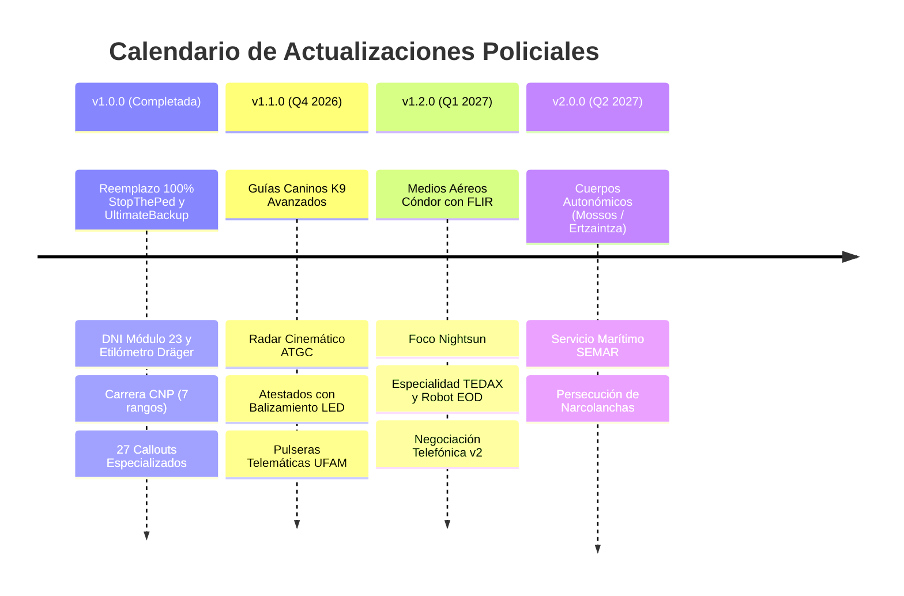

# 🗺️ Hoja de Ruta Oficial (Roadmap) — LSPDFR Spanish Police Suite

[-brightgreen.svg)]()

Este documento detalla la planificación estratégica, el calendario de desarrollo y las especificaciones técnicas de las próximas versiones de **LSPDFR Spanish Police Suite**.

---

## 📅 Resumen del Calendario de Versiones

---

## 📦 Versión 1.0.0 — Lanzamiento Inicial Oficial (Estado: ✅ COMPLETADA)

* **Reemplazo 100% de StopThePed**:
  - Escolta cinemática física de brazo (`ATTACH_ENTITY_TO_ENTITY`).
  - Embarque en patrulla con bloqueo automático de seguridad infantil (`SET_VEHICLE_DOORS_LOCKED = 4`).
  - Desembarque seguro junto al vehículo policial.
  - Posturas de espera controlada: arrodillarse, sentarse en bordillo y ponerse de pie.
  - Interacción en parada de tráfico con bajada de ventanilla, apagado forzoso de motor, contacto visual interactivo y diálogos en 3 niveles de conducta en español.
* **Reemplazo 100% de UltimateBackup**:
  - Bandas de clavos tácticas punzantes con reventón instantáneo de los 4 neumáticos (`SET_VEHICLE_TYRE_BURST`).
  - Bloqueo táctico de carretera en formación V a 200 metros con 2 operadores GEO armados en cobertura.
  - Maniobra PIT física asistida por impulso angular sobre el eje trasero.
  - Maniobra de caja (Boxing-In) coordinada por radio SIRDEE.
* **Identificación Oficial y Pruebas Científicas**:
  - Algoritmo matemático oficial de DNI / NIE (Módulo 23).
  - Etilómetro Dräger Alcotest en aire espirado con tasas legales DGT.
  - Test de saliva Dräger DrugTest 5000 (Cocaína, Opiáceos, THC y Anfetaminas).
  - Terminal policial SITEL y lectura de derechos (Art. 520 LECrim).
* **Módulos Tácticos y de Carrera**:
  - Carrera CNP con 7 rangos reales, puntos de experiencia (XP), medallas al mérito y nóminas mensuales (+30% plus nocturno).
  - Gestión de escenas con conos, barreras New Jersey y desvío inteligente de tráfico IA.
  - Botiquín táctico IFAK (torniquete CAT, vendajes hemostáticos, DEA y Naloxona).
  - Entrada táctica CQB en Stack con ariete, escopeta, cargas explosivas y flashbangs.
  - Radio SIRDEE con microfonía real, códigos 10 españoles, botón de pánico 10-99, reloj legal de 72h y juicios penales.
  - 27 misiones de intervención especial de élite.

---

## 🚀 Versión 1.1.0 — Expansión Operativa K9 y Tráfico ATGC (Estado: 🔄 EN DESARROLLO)

*Fecha estimada: Octubre de 2026 | Milestone: `v1.1.0`*

### 🐕 1. Especialidad de Guías Caninos (K9) Avanzada
- **Comandos Dinámicos del Pastor Alemán / Belga Malinois**:
  - *«Busca Droga»*: El can olfatea maleteros, guanteras e interior de vehículos marcando pasivamente (sentado junto al punto caliente) si halla sustancias ilícitas.
  - *«Rastreo de Huella»*: Búsqueda de personas desaparecidas o fugitivos que hayan abandonado un vehículo a pie a través de su rastro olfativo.
  - *«Ataque y Presa»*: Lanzamiento del can a la carrera contra sospechosos armados o en fuga, mordiendo el antebrazo y derribándolos al suelo para permitir el engrilletamiento seguro del agente.
- **Vehículo K9 Adaptado**: Jaula posterior integrada con apertura a distancia mediante tecla rápida.

### 🚔 2. Agrupación de Tráfico de la Guardia Civil (ATGC)
- **Cinemómetro Móvil Embarcado (Radar de Velocidad)**:
  - Sistema de medición doppler cinemático capaz de medir la velocidad de vehículos en movimiento por delante y por detrás del coche patrulla.
  - Captura automática de matrícula y emisión instantánea de boletín de denuncia por exceso de velocidad según el baremo de la DGT.
- **Furgón de Atestados y Control de Alcoholemia Masivo**:
  - Despliegue de carpa exterior iluminada para controles de alcoholemia masivos.
  - Etilómetro evidencial de precisión Dräger 7110 de alta exactitud con emisión de ticket impreso.
  - Señalización luminosa secuencial LED de alta visibilidad para cortes nocturnos en autopistas.

### 📱 3. Unidad de Familia y Mujer (UFAM) v2
- **Dispositivo Telemático de Control (Pulsera de Alejamiento)**:
  - Alerta por radio SIRDEE si un agresor con orden cautelar vulnera el perímetro de seguridad de 500 metros alrededor del domicilio o posición de la víctima.

---

## 🚁 Versión 1.2.0 — Medios Aéreos Cóndor y Desactivación TEDAX (Estado: 📌 PLANIFICADA)

*Fecha estimada: Diciembre de 2026 | Milestone: `v1.2.0`*

### 🛸 1. Servicio de Medios Aéreos (Helicóptero Cóndor)
- **Cámara Giroestabilizada FLIR (Visión Infrarroja y Térmica)**:
  - Posibilidad de alternar a la cámara del operador de vuelo del Cóndor en persecuciones complejas.
  - Visión térmica en blanco/negro y arcoíris para localizar personas ocultas bajo la maleza o tejados en horas nocturnas.
- **Foco de Alta Intensidad *Nightsun***:
  - Haz de luz de 30 millones de candelas que ilumina y enceguece temporalmente a sospechosos a pie, reduciendo su velocidad de carrera.

### 💣 2. Especialidad TEDAX-NRBQ (Desactivación de Explosivos)
- **Robot de Desactivación Teleoperado**:
  - Control de orugas robóticas para aproximación remota a bultos sospechosos o vehículos con artefacto.
  - Disparo de cañón de agua disyuntor de alta presión para neutralizar detonadores sin riesgo para el personal humano.
- **Equipo de Protección EOD**:
  - Traje balístico pesado de desactivación de 35 kg con resistencia reforzada a ondas expansivas.

### 📞 3. Negociación de Crisis Telefónica v2
- Integración de llamadas de voz entre el negociador policial y el teléfono móvil del secuestrador o atrincherado.
- Entrega de avituallamiento táctico o teléfono señuelo para obtener inteligencia visual del interior del inmueble.

---

## 🌊 Versión 2.0.0 — Cuerpos Autonómicos y Vigilancia Marítima (Estado: 📌 PLANIFICADA)

*Fecha estimada: Primavera de 2027 | Milestone: `v2.0.0`*

### 👮 1. Cuerpos Policiales Autonómicos
- **Mossos d'Esquadra** (Cataluña):
  - Procedimientos de Seguridad Ciudadana (USC), Área Regional de Recursos Operativos (ARRO) y Grupo Especial de Intervención (GEI).
  - Voces y despacho de radio en catalán y castellano.
- **Ertzaintza** (País Vasco):
  - Unidades de Protección Ciudadana y Brigada Móvil (*Beltzak*).
  - Códigos de radio operativos propios.
- **Policía Foral de Navarra** y **Policía Canaria**.

### ⚓ 2. Servicio Marítimo de la Guardia Civil (SEMAR)
- Patrulleras ligeras y embarcaciones de alta velocidad (RIBs) para intercepción de narcolanchas en aguas costeras y puertos.
- Abordaje táctico en alta mar y persecuciones acuáticas de contrabandistas.

---

## 💡 Cómo Proponer Nuevas Funcionalidades
Si tienes ideas para enriquecer la suite o conoces procedimientos policiales específicos que te gustaría ver en próximas versiones:
1. Abre una propuesta en la pestaña **[Issues / Feature Request](https://github.com/jpscalero/LSPDFR-Spanish-Police-Suite/issues)**.
2. Participa en el tablero interactivo de **[Projects](https://github.com/users/jpscalero/projects/10)**.
